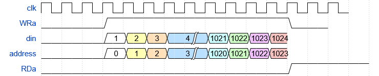
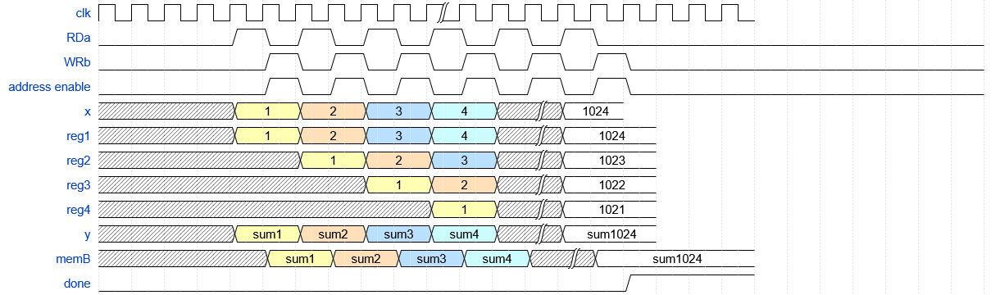

# 8-Bit Digital FIR Filter: RTL Architecture & VHDL Implementation

## Overview

This repository contains the complete Register-Transfer Level (RTL) design, simulation, and verification of an **8-bit 4-tap Digital FIR Filter** developed in VHDL. The system acquires 1,024 8-bit signed samples into an input memory (`MEM_A`), processes them through a custom hardware **Datapath** governed by a Finite State Machine (**Control Unit**), and stores the filtered, overflow-saturated results into an output memory (`MEM_B`).

The hardware implements the following discrete-time difference equation with zero initial conditions ($X(k) = 0$ for $k < 0$):

$$
Y(n) = -0.5X(n) - 2X(n-1) + 4X(n-2) + 0.25X(n-3)
$$

## Repository Structure

```
VHDL-Digital-FIR-Filter-Datapath-CU/
├── src/
│   ├── filter.vhd          # Top-level structural entity connecting CU, Datapath, and Memories
│   ├── control_unit.vhd    # 5-state Moore/Mealy FSM governing memory & datapath timing
│   ├── datapath.vhd        # Structural datapath (shift register, shifters, 2's comp, adder, saturation)
│   ├── memory.vhd          # Behavioral 1024x8-bit RAM (synchronous write, asynchronous read)
│   ├── regn.vhd            # Parametric N-bit register with synchronous reset and enable
│   ├── shifter.vhd         # Configurable 1-bit / 2-bit left/right arithmetic shifter
│   ├── inverter.vhd        # 8-bit two's complement negator (~A + 1)
│   ├── adder.vhd           # 4-input signed adder with 8-to-10-bit sign extension
│   ├── comparator.vhd      # 10-bit signed range detector ([-128, +127])
│   ├── mux3to1.vhd         # 3-to-1 output multiplexer for overflow saturation clamping
│   └── counter_10bit.vhd   # 10-bit address generator (0 to 1023) with terminal count flag
├── tb/
│   └── filter_tb.vhd       # VHDL testbench with 18-sample stimulus sequence
├── images/
│   ├── wavedrom_load.png   # Pre-simulation WaveDrom timing diagram (MEM_A write phase)
│   └── wavedrom_filter.png # Pre-simulation WaveDrom timing diagram (2-cycle filter loop)
└── README.md
```

## Hardware Architecture & Engineering Trade-offs

### 1. Multiplier-less Arithmetic (Shift-and-Add Optimization)

* **Design Choice:** Since all filter coefficients ($-0.5, -2, +4, +0.25$) are powers of two, full hardware multipliers are completely eliminated in favor of **binary shifters** (`shifter.vhd`) and **two's complement inverters** (`inverter.vhd`).

* **Trade-off:** Eliminating multipliers drastically reduces silicon area, critical path delay, and dynamic power consumption. However, integer right-shifting introduces **truncation toward zero** for fractional terms (e.g., `00000001` shifted right by 1 yields `00000000`, treating $0.5 \times 1$ as $0$), which was explicitly accounted for during functional verification.

### 2. Datapath Pipeline & Sign-Extended Saturation Logic

* **4-Stage Delay Line:** Four cascaded 8-bit registers (`regn.vhd`) form a synchronous FIFO shift register holding $X(n), X(n-1), X(n-2), X(n-3)$.

* **Overflow Prevention (8-bit** $\rightarrow$ **10-bit):** Summing four 8-bit signed operands can exceed the $[-128, +127]$ dynamic range. To prevent intermediate wrap-around errors, `adder.vhd` sign-extends each operand to **10 bits** (prepending `"00"` if MSB is `'0'`, or `"11"` if MSB is `'1'`) prior to summation.

* **Saturation Clamping:** The 10-bit sum $S$ feeds `comparator.vhd` and `mux3to1.vhd`:

  * $S > +127 \implies \text{Output clamped to } \texttt{01111111 } (+127)$

  * $S < -128 \implies \text{Output clamped to } \texttt{10000000 } (-128)$

  * $-128 \le S \le +127 \implies \text{Output} = S[7:0]$

### 3. Control Unit FSM & 2-Cycle Execution Trade-off

The Control Unit (`control_unit.vhd`) is designed as a 5-state synchronous FSM (`DONE`, `WRITEA`, `RST_COUNTER`, `READA`, `WRITEB`):

* **Shared Address Bus Optimization:** Both `MEM_A` and `MEM_B` share a single 10-bit address counter (`counter_10bit.vhd`).

* **2-Cycle Processing Loop:** Because `MEM_A` must be read asynchronously, shifted into the Datapath registers, processed combinationally, and written synchronously into `MEM_B` at the *same* address before incrementing the counter, the filtering phase alternates between two states per sample:

  1. `READA` (Cycle 1): Asserts `CS_A`, `RD`, and `enable_register` to latch $X(n)$ into the shift register and compute $Y(n)$.

  2. `WRITEB` (Cycle 2): Asserts `CS_B`, `WR`, and `enable_count` to store $Y(n)$ into `MEM_B[addr]` and increment the address pointer.

* **Trade-off:** Alternating `READA` and `WRITEB` requires $2 \times 1024$ clock cycles for the filtering phase, trading a modest latency increase for minimal hardware complexity (single address counter, zero dual-port memory overhead, and safe setup/hold timing margins).

## Timing Diagrams & Verification

### Pre-Simulation Timing Design (WaveDrom)

Before writing RTL code, cycle-accurate timing diagrams were drafted using WaveDrom to verify synchronization between memory control signals (`WRa`, `RDa`, `WRb`), the address counter, and the 4-stage shift register pipeline:


*Figure 1: Data acquisition phase (`WRITEA` state) loading 1,024 samples into `MEM_A`.*


*Figure 2: Alternating `READA` / `WRITEB` execution loop computing $Y(n)$ and storing results into `MEM_B`.*

### Functional Verification

1. **RTL Simulation:** Simulated in ModelSim (`filter_tb.vhd`) using an 18-sample test vector covering positive/negative values, zero-padding startup transients, and positive/negative overflow conditions.

2. **MATLAB Golden Model Cross-Check:** A bit-accurate MATLAB reference model replicating two's complement arithmetic, shift truncation, and saturation limits confirmed a **100% match** with the simulated hardware outputs:

   ```
   Filter Output (Signed Decimal):
   [0, 0, -4, -4, 14, -5, -42, -18, -23, 23, 67, 127, 127, -25, -100, 127, -128, 127]
   ```